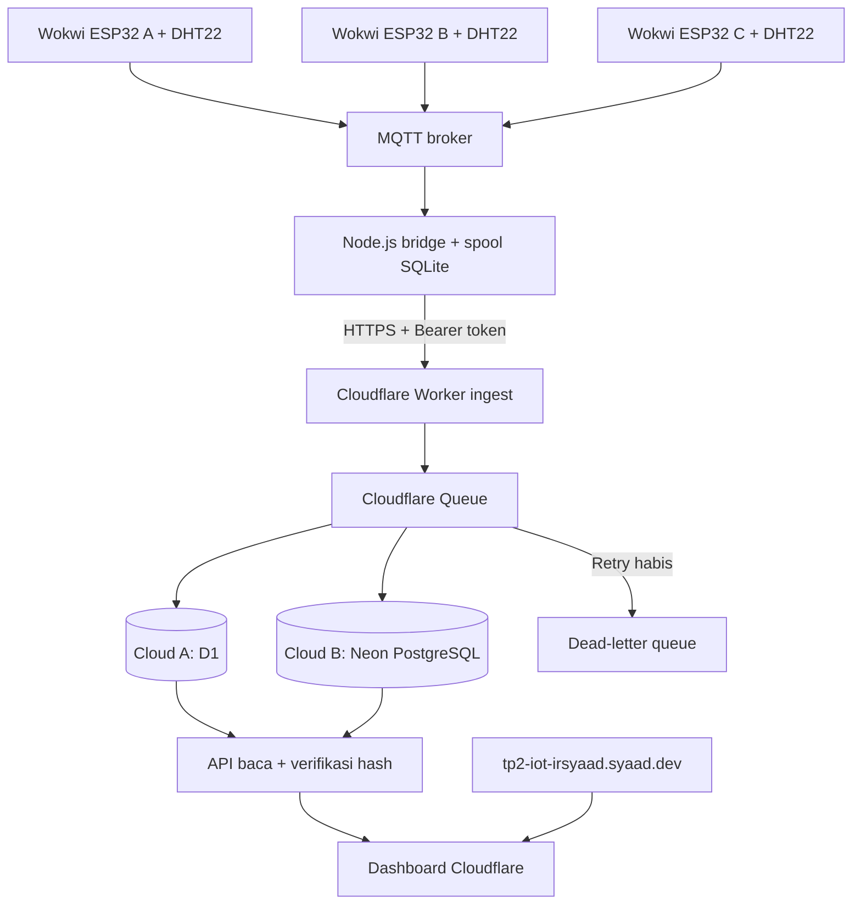

# TP2 IoT Irsyaad

Firmware tiga ESP32 + DHT22 di Wokwi, bridge MQTT, API Cloudflare Worker, D1 utama, Neon cadangan, dan dashboard monitoring.

Dashboard: https://tp2-iot-irsyaad.syaad.dev

Repository: https://github.com/irsyaadbp/tp2-iot

Repository Git menyimpan backend, bridge, dashboard, dan konfigurasi contoh. Firmware serta diagram simulasi dikelola langsung di Wokwi cloud. Secret lokal, dependency terpasang, dan data runtime tidak di-commit.

## Arsitektur yang diimplementasikan



Bridge adalah proses Node.js yang harus tetap berjalan. Untuk demo, jalankan di laptop. Deployment Worker tidak menjalankan subscriber MQTT ini. Agar penerimaan data terus berjalan saat laptop mati, jalankan bridge di VPS/container yang selalu aktif dan gunakan volume persisten untuk spool SQLite.

## Struktur

- `WOKWI.md`: tautan tiga simulasi Wokwi cloud dan petunjuk menjalankannya.
- `src/worker.js`: ingest, consumer replikasi, snapshot, dan fallback baca.
- `src/protocol.js`: format data dan pemeriksaan SHA-256.
- `bridge/index.js`: subscriber MQTT QoS1 dan pengiriman HTTP dengan retry.
- `public/`: dashboard tanpa framework, polling setiap 5 detik, grafik, tabel hash, dan ekspor CSV.
- `migrations/0001_readings.sql`: schema untuk D1 dan PostgreSQL.
- `tests/`: pengujian integritas, API, replikasi, dan pipeline MQTT lokal.

## Menjalankan tiga Wokwi

Tiga proyek ESP32 + DHT22 dijalankan langsung di Wokwi online:

- [Lokasi A](https://wokwi.com/projects/477479053733443585)
- [Lokasi B](https://wokwi.com/projects/477479046676524033)
- [Lokasi C](https://wokwi.com/projects/477479062154561537)

Buka setiap tautan di tab terpisah dan klik Run. Klik komponen DHT22 untuk mengubah suhu dan kelembapan. Firmware menerbitkan pembacaan setiap 5 detik setelah WiFi, MQTT, dan waktu NTP tersedia.

Broker: `test.mosquitto.org:1883`. Topic: `tp2/irsyaad-7fa913c2/+/telemetry`. Jalankan `npm run bridge` dari repository untuk meneruskan pembacaan ke API. Konfigurasi Neon harus selesai sebelum data masuk ke dashboard cloud.

Tautan di atas mengarah ke salinan proyek pada akun pengguna. Firmware dan diagram dikelola di editor Wokwi online.

## Menjalankan bridge ke dashboard cloud

Butuh Node.js >= 22.18. Jalankan perintah dari folder proyek ini:

```sh
npm ci
npm run setup:local
npm run bridge
```

Di workspace tempat program dibuat, token yang sama sudah disimpan dalam `.dev.vars`, `bridge/.env`, dan Worker secret. Jangan menggantinya hanya pada salah satu tempat. Arsip program sengaja tidak berisi secret. Untuk memakai arsip di komputer lain, konfigurasi token yang sama secara aman atau buat token baru dan upload ke Worker.

Periksa `bridge/.env`: `API_URL` harus menuju `https://tp2-iot-irsyaad.syaad.dev/api/ingest`. `MQTT_TOPIC` harus cocok dengan namespace firmware, dengan `+` untuk lokasi. Jangan membuka `.env` atau connection string ke repositori publik.

Bridge menyimpan pesan yang diterima ke SQLite sebelum mengakuinya ke broker. Setelah API menerima pesan ke antrean cloud (HTTP 202), baris spool dihapus. Jika HTTP gagal, bridge mencoba ulang dengan jeda bertambah. Payload yang ditolak 400/413/422 dipindahkan ke tabel `rejected` pada spool untuk diperiksa.

## Koneksi Neon

Proyek yang sudah dibuat: `tp2-iot-irsyaad`, ID `blue-tree-06987967`, region Singapore, PostgreSQL 18. Database `tp2_iot`, branch `production` (`br-gentle-mouse-b3pii0e6`).

Simpan connection string PostgreSQL sebagai baris `NEON_DATABASE_URL=...` di `.dev.vars`. Jangan tempel di chat. Terapkan schema sekali, lalu upload secrets:

```sh
npm run db:neon
npm run secrets:upload
```

Worker menggunakan driver `@neondatabase/serverless` melalui HTTPS. Dashboard mengakses Neon melalui Worker; connection string tidak pernah dikirim ke browser.

Ingest tetap menerima data ketika Neon belum dikonfigurasi. Consumer menyimpan data ke D1 dan mencatat replikasi yang tertunda di tabel `backup_pending`. Dashboard menampilkan pembacaan dari D1; pemeriksaan antar-cloud belum tersedia sampai Neon terhubung.

## Cloudflare

Worker `tp2-iot-irsyaad`, D1 `tp2-iot-primary`, antrean `tp2-iot-readings`, dan antrean gagal `tp2-iot-dead-letter` sudah disiapkan pada akun Cloudflare pengguna. Domain memakai custom domain Worker. Detail binding ada di `wrangler.jsonc`.

Untuk deployment berikutnya:

```sh
npx wrangler login
npm run db:remote
npm run check
npm test
npm run build
npm run deploy
```

Untuk akun lain, buat database dan dua antrean baru dengan Wrangler; ubah `account_id`, `database_id`, dan custom domain pada konfigurasi. Paket ini menyertakan konfigurasi deployment akun pembuat, tanpa token akun.

## Retry dan cadangan

Consumer mencoba penulisan D1 dan Neon secara independen. Pesan diakui setelah D1 tersimpan dan backup berhasil atau pekerjaan backup tercatat secara persisten di D1. Scheduled Worker setiap menit mencoba hingga 20 pekerjaan backup tertunda, lalu menghapus pekerjaan hanya setelah hash salinan Neon cocok. Jika D1 atau pencatatan pekerjaan gagal, pesan Queue dicoba ulang. Penulisan ulang dengan ID dan hash sama tidak membuat baris ganda. ID sama dengan hash berbeda ditolak dan perlu investigasi.

Jika penulisan utama gagal setelah 20 retry, pesan masuk `tp2-iot-dead-letter`. Antrean ini menyimpan pesan terbatas waktu (Cloudflare mendokumentasikan 4 hari untuk DLQ tanpa consumer). Pantau antrean dan replay pesan setelah layanan pulih; retry ini bukan jaminan penyimpanan tanpa batas. Cadangan Neon adalah salinan pembacaan aktif; belum mencakup backup otomatis seluruh schema atau pemulihan bencana lengkap.

Jika D1 gagal dibaca, API mengembalikan data Neon. Jika salah satu cloud tidak dapat dibaca, status integritas menjadi belum terverifikasi. Hosting, API, dan antrean masih bergantung pada Cloudflare; gangguan menyeluruh Cloudflare tidak diatasi oleh fallback database ini.

## Makna verifikasi

Perangkat menghitung SHA-256 dari JSON dengan urutan tetap:

`v, device, session, seq, timestamp, temp_centi, humidity_centi, prev_hash`.

ID adalah `device:session:seq`. Pembacaan pertama memakai 64 nol sebagai hash sebelumnya.

API menghitung ulang hash masing-masing cloud, membandingkan payload/hash antar-cloud, dan memeriksa hubungan dengan pembacaan sebelumnya dalam jendela 60 pembacaan per lokasi.

- Hash cocok: payload/hash sama dan hash yang dihitung ulang benar.
- Belum tersalin: salah satu salinan belum ada dalam jendela baca.
- Data berubah: hash tidak cocok dengan payload, atau hubungan hash pendahulu terputus.
- Cloud berbeda: payload valid tetapi berbeda antar-cloud untuk ID yang sama.
- Rantai belum lengkap: pendahulu hilang di tengah jendela baca.
- Pendahulu di luar jendela: batas awal jendela belum diverifikasi.

Ini demonstrasi rantai hash, bukan blockchain publik atau bukti mutlak bahwa data asli. Penyerang yang mengganti kedua salinan dan menghitung ulang seluruh rantai dapat lolos tanpa acuan hash independen. Pemeriksaan riwayat dibatasi jendela baca; bukan audit seluruh database.

## Pengujian lokal

```sh
npm run db:local
npm run dev
```

Dashboard lokal: http://127.0.0.1:8787. Pada terminal lain:

```sh
npm test
npm run test:pipeline
```

Pipeline menggunakan broker MQTT lokal pada port 1884 dan data sintetis di D1 lokal. Tidak menulis data uji ke database produksi. Replikasi Neon tertunda disimpan di D1 lokal jika Neon belum dikonfigurasi.

`scripts/demo-publisher.js` tersedia untuk demo sintetis eksplisit melalui MQTT. Jalankan hanya dengan namespace dan lingkungan demo terpisah: `CONFIRM_SYNTHETIC=yes npm run demo`. Ini tidak menggantikan simulasi Wokwi.

## Endpoint

- `POST /api/ingest`: Bearer token wajib; menerima satu payload, memvalidasi hash, lalu mengantrekan. HTTP 202 menunjukkan diterima antrean, belum berarti kedua database sudah ditulis.
- `GET /api/snapshot`: riwayat, sumber fallback, status cloud, serta hasil verifikasi per pembacaan.
- `GET /api/health`: status konfigurasi tanpa membocorkan secret.

Dokumentasi sumber: [Wokwi WiFi](https://docs.wokwi.com/guides/esp32-wifi), [Cloudflare D1](https://developers.cloudflare.com/d1/worker-api/), [Cloudflare Queues DLQ](https://developers.cloudflare.com/queues/configuration/dead-letter-queues/), [Neon serverless driver](https://neon.com/blog/serverless-driver-ga).

Jadwal replikasi memakai [Cloudflare Cron Triggers](https://developers.cloudflare.com/workers/configuration/cron-triggers/). Perubahan jadwal dapat memerlukan waktu propagasi.
